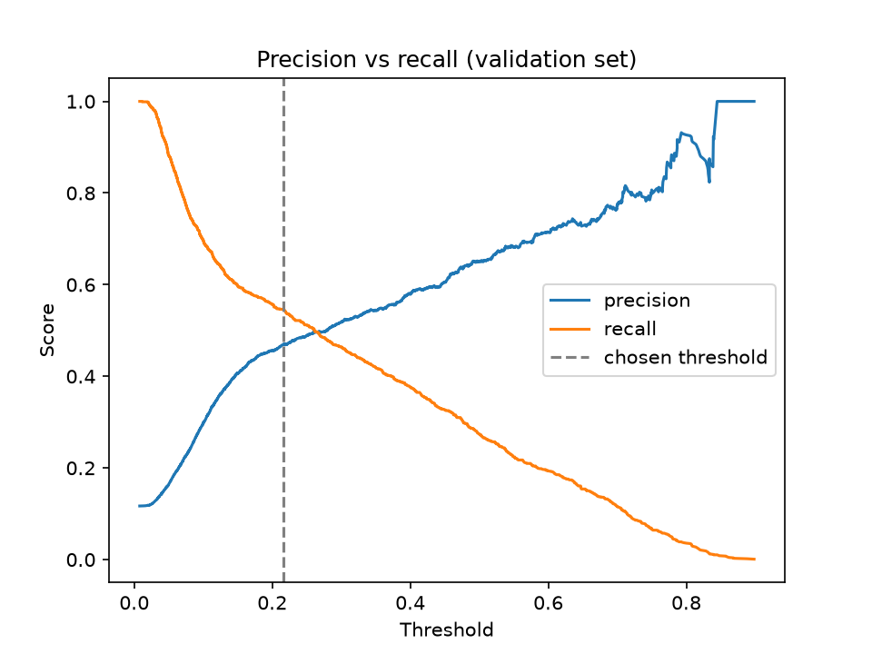
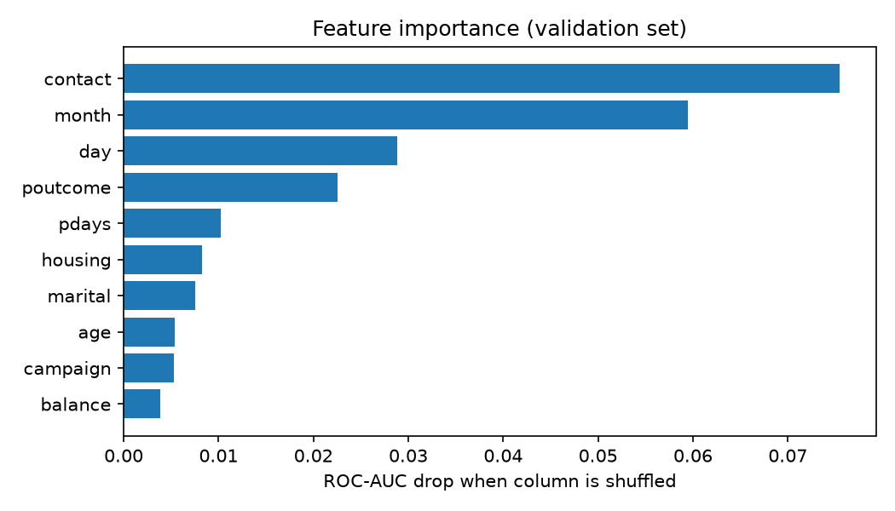

# Bank Marketing: Leakage-Safe ML Benchmark

Predicts whether a customer subscribes to a term deposit using the [UCI Bank Marketing dataset](https://archive.ics.uci.edu/dataset/222/bank+marketing), licensed under CC BY 4.0.

## Key Decisions

- **Prevent data leakage:** Drop `duration` because call duration is only known after the call and would not be available when deciding whom to contact beforehand.
- **Split before preprocessing:** Use stratified data splitting to preserve class proportions and fit preprocessing only on training data.
- **Establish a baseline:** Compare a majority-class baseline, balanced logistic regression, and gradient boosting.
- **Use appropriate metrics:** Evaluate macro-F1 and ROC-AUC alongside precision and recall. Accuracy alone can be misleading because approximately 88% of customers do not subscribe.
- **Tune thresholds safely:** Select the decision threshold using validation data, never the held-out test set.

## Project Structure

```text
.
├── data/
│   └── bank-full.csv
├── results/
│   ├── threshold_curve.png
│   └── feature_importance.png
├── src/
│   ├── __init__.py
│   ├── train.py
│   └── analyze.py
├── tests/
├── .gitignore
├── requirements.txt
└── README.md
```

## Setup and Run

### 1. Download the dataset

Download `bank-full.csv` from the [UCI Bank Marketing dataset page](https://archive.ics.uci.edu/dataset/222/bank+marketing) and place it inside the `data/` directory.

### 2. Install dependencies

```bash
pip install -r requirements.txt
```

### 3. Run tests

```bash
python -m pytest
```

### 4. Train and evaluate the models

```bash
python -m src.train
```

### 5. Analyze thresholds, feature importance, and errors

```bash
python -m src.analyze
```

Run these commands from the project root directory.

## Milestones

| Milestone | Objective | Implementation |
|---|---|---|
| M2 | Establish a baseline and compare logistic regression with gradient boosting | `src/train.py` |
| M3 — Stage 1 | Tune the decision threshold using validation data | `src/analyze.py` |
| M3 — Stage 2 | Analyze feature importance and prediction errors | `src/analyze.py` |

## M2 Results: Model Comparison

Results on the held-out test set.

| Model | Macro-F1 | Precision | Recall | ROC-AUC |
|---|---:|---:|---:|---:|
| Majority baseline | 0.4689 | 0.0000 | 0.0000 | 0.5000 |
| Logistic regression (balanced) | 0.6104 | 0.2662 | 0.6238 | 0.7722 |
| Gradient boosting | 0.6452 | 0.6469 | 0.2372 | 0.8026 |

### Observations

- **Logistic regression** identifies more subscribers, achieving a recall of 62.38%, but generates more false positives.
- **Gradient boosting** achieves the highest macro-F1 and ROC-AUC among the evaluated models, but its default threshold produces lower recall.
- The majority baseline demonstrates why accuracy alone is insufficient for an imbalanced classification problem.

## M3 — Stage 1: Decision Threshold Tuning

Gradient boosting is trained on 60% of the data. The decision threshold is selected using a separate 20% validation set, and the final evaluation is performed on the remaining 20% test set.

| Setting | Threshold | Precision | Recall | F1 (Yes) | Macro-F1 |
|---|---:|---:|---:|---:|---:|
| Default | 0.500 | 0.6414 | 0.2401 | 0.3494 | 0.6463 |
| Tuned | 0.217 | 0.4736 | 0.5180 | 0.4948 | 0.7122 |

### What Changed?

Reducing the threshold from 0.500 to 0.217 more than doubles subscriber recall, increasing it from approximately 24% to 52%.

The trade-off is lower precision: approximately 64% to 47%. The model identifies more potential subscribers but also generates more false positives.

The tuned threshold improves macro-F1 from 0.6463 to 0.7122 on the held-out test set.

The underlying model's ranking ability, measured by ROC-AUC, does not change when only the decision threshold changes.



## M3 — Stage 2: Feature Importance and Error Analysis

### 1. Permutation Feature Importance

Permutation importance is calculated on the validation set using the decrease in ROC-AUC after randomly shuffling a feature. A larger decrease indicates that the model relies more heavily on that feature for its predictive performance.

| Feature | ROC-AUC Drop |
|---|---:|
| `contact` | 0.0755 |
| `month` | 0.0595 |
| `day` | 0.0288 |
| `poutcome` | 0.0225 |
| `pdays` | 0.0102 |



**Interpretation:** Contact method and campaign month have the largest measured importance among the listed features. These results describe predictive usefulness, not causal effects. Correlated features can also influence permutation importance.

### 2. Prediction Error Analysis

At the tuned threshold of 0.217, the reported test-set results are:

| Outcome | Count |
|---|---:|
| Correct predictions | 7,924 |
| False positives (false alarms) | 609 |
| False negatives (missed subscribers) | 510 |

False positives are customers predicted to subscribe who did not. False negatives are customers who subscribed but were not identified by the model.

These figures describe the reported error analysis; they do not include true negatives in the table.

### 3. Missed Subscribers by Month

Reported false-negative rates among actual subscribers:

| Month | Missed Subscribers |
|---|---:|
| May | 74% |
| July | 73% |
| November | 68% |
| August | 63% |
| June | 41% |

### 4. Missed Subscribers by Job

Reported false-negative rates among actual subscribers:

| Job Category | Missed Subscribers |
|---|---:|
| Blue-collar | 66% |
| Services | 61% |
| Management | 49% |

These patterns can help identify customer segments for further investigation. However, subgroup rates may be affected by sample size, customer characteristics, campaign practices, and the chosen threshold.

**Important:** Feature importance and error analysis reveal patterns in model predictions. They do not establish that a feature or customer characteristic causes subscription outcomes.

## Limitations

- Evaluation uses a single train/validation/test split rather than repeated cross-validation.
- Hyperparameter tuning has not been performed.
- The decision threshold maximizes F1, which balances precision and recall without explicitly accounting for business costs.
- A real bank should select its threshold based on contact costs, expected subscription value, customer experience, and operational constraints.
- M3 uses a different training-data proportion from M2, so its default-threshold results may differ slightly from the M2 gradient-boosting results.
- The dataset comes from a single Portuguese bank, which limits how confidently the results can be generalized to other markets.
- The reported results depend on the specific split, preprocessing pipeline, model configuration, and evaluation implementation.

## Next Steps

- [ ] **M4:** Experiment with hyperparameter tuning and cross-validation.
- [ ] **M5:** Track experiments and metrics with MLflow.
- [ ] **M6:** Serve predictions through a FastAPI endpoint.
- [ ] **M7:** Containerize the application with Docker.
- [ ] **M8:** Add automated tests and CI using GitHub Actions.

## Dataset and License

- **Dataset:** [UCI Bank Marketing](https://archive.ics.uci.edu/dataset/222/bank+marketing)
- **License:** CC BY 4.0
- **Task:** Binary classification — predict whether a customer subscribes to a term deposit.

---

**Project focus:** Leakage-safe preprocessing, imbalanced classification, threshold selection, model evaluation, permutation importance, and error analysis.
